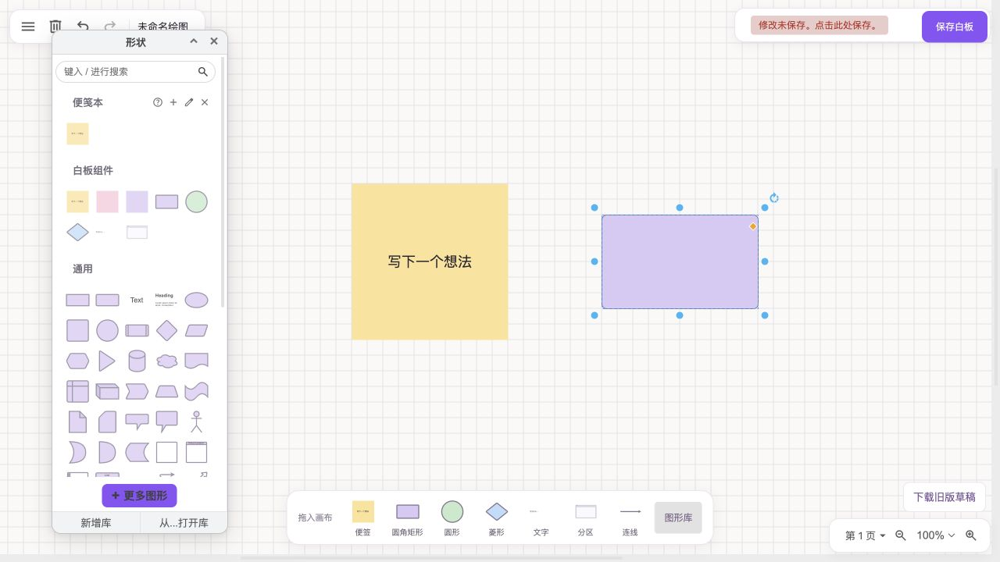

# Gatherboard

**A quiet space for your ideas.**

Gatherboard is a personal whiteboard built on the **native draw.io editor**. It brings a FigJam-inspired floating interface and a small set of ready-to-use shapes to draw.io, while keeping its drawing tools, custom libraries, Scratchpad, file formats, and undo history.



## Start locally

Requires Python 3 and a modern browser. No package installation or build step is needed.

```sh
./run-gatherboard.sh
```

Open **http://127.0.0.1:8765/jam.html**.

## What it does

- Native draw.io Sketch interface with floating controls and a reusable-shape dock.
- Sticky notes, rounded rectangles, circles, diamonds, text, connectors, and sections.
- Native custom shape libraries and Scratchpad for collecting and reusing your own components.
- A uniform native grid configured with `defaultGridSize: 20` and `gridSteps: 1`.
- Native drag previews, snapping, zoom, clipboard, undo, formatting, and file operations.
- Uncompressed XML by default, suitable for local ownership and Git history.
- No emoji or freehand tools in the Gatherboard interface.

## Built on draw.io

This is a fork of [jgraph/drawio](https://github.com/jgraph/drawio), not a separate drawing engine. Gatherboard uses `DRAWIO_CONFIG`, custom CSS, and `Draw.loadPlugin` to adapt the complete draw.io App / EditorUi. The shortcut dock uses the same Sidebar template factories as native libraries.

The customizations live in `src/main/webapp/jam/`, with small integration changes to `PreConfig.js`, `PostConfig.js`, and `bootstrap.js`. Open `/index.html` without `jam=1` to use the upstream editor.

## Status

Early working prototype. Desktop drag placement has been checked at 100%, at 50%, and after scrolling. Native Scratchpad collection and reuse have been verified. Mobile touch, complex custom shapes, and broader cross-browser compatibility still need testing. This is not a pixel-perfect FigJam clone and has no added collaboration service.

- [中文运行与架构说明](JAM.md)
- [Implementation notes](docs/jam/PLAN.md)
- [Verification notes](docs/jam/VERIFICATION.md)
- [Upstream README](README.upstream.md)

## License and attribution

The source code retains the upstream [Apache License 2.0](LICENSE). Upstream icon sets, stencil libraries, templates, and third-party assets retain their own applicable terms; see the [upstream README](README.upstream.md#license). Gatherboard is not affiliated with Figma. Diagram files created by users remain their own.
